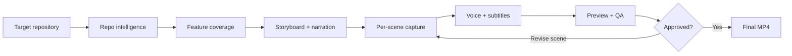

# AI Video Producer

<p align="center">
  <strong>From a software repository to a reviewable video — one scene at a time.</strong>
</p>

<p align="center">
  <a href="https://github.com/Irthn1311/AI-Video-Producer/actions/workflows/ci.yml"></a>
  <a href="LICENSE"></a>
  
  
</p>

<p align="center">
  <a href="README.vi.md">Tiếng Việt</a> ·
  <a href="docs/quickstart.md">Getting started</a> ·
  <a href="docs/architecture.md">Architecture</a> ·
  <a href="docs/skills.md">Agent skills</a> ·
  <a href="docs/roadmap.md">Roadmap</a>
</p>

**AI Video Producer (AVP)** is an open-source, local-first toolkit for creating **authentic software demo videos** with AI coding agents. It combines reusable agent instructions, per-scene production workflows, and a Node.js CLI that handles recording, media assembly, review checkpoints, and export.

Bring your own **Codex, Claude Code, Gemini CLI, or compatible coding agent**. AVP provides the workflow; your agent researches the product, verifies the features, and writes the story. The CLI executes and tracks the production steps.

## How it works



**Scene-first by design.** Each scene keeps its own footage, narration, subtitles, preview, QA evidence, and review status. Previously approved scenes are protected from accidental regeneration. Changes invalidate dependent artifacts rather than restarting the entire project.

## Features

| Capability | What it provides |
| --- | --- |
| **Agent-agnostic** | `AGENTS.md`, `CLAUDE.md`, `GEMINI.md`, and focused Agent Skills |
| **Low-token repo research** | Local inventory, bundled Graphify skill and optional Graphify CLI / Aider RepoMap / Serena |
| **Real browser capture** | Playwright-recorded UI interactions in an isolated demo environment |
| **Scene-level production** | Independent capture, narration, captions, preview, QA, and approval |
| **Cost-aware voiceover** | Optional Gemini TTS; configurable language and voice, explicit API opt-in, estimated-cost guard |
| **Incremental builds** | Content fingerprints and artifact hashes to detect work that needs rebuilding |
| **Video output** | FFmpeg preview/export, with an optional Remotion rendering backend |
| **Auditable results** | Local state, scene reports, QA records, and a reproducible project configuration |

The first module is **`software-demo`**. The architecture leaves room for future explainer and marketing-video modules. AVP v0.1 is an extensible toolkit, **not a hosted or fully autonomous video service**.

## Bundled Agent Skills

AVP includes **10 production skills, 7 AVP-authored Remotion workflow skills and the full Apache-licensed Graphify agent skill with its reference files** in [`.agents/skills/`](.agents/skills/). Your coding agent can read the instructions immediately after cloning, without installing a separate skills package.

The Graphify Python runtime, Playwright browser and Remotion npm dependencies are separate executables and still need installation if you use those capabilities. If you specifically want the **official Remotion skill text**, install it from the publisher with `npx skills add remotion-dev/skills`; AVP's bundled `avp-remotion-*` guides are original, not copies of upstream. See [skill catalog](docs/skills.md) and [third-party provenance](docs/third-party-skills.md).

## Quickstart

**Requirements:** Node.js 22+, Git, FFmpeg and ffprobe. Chromium is needed for automated browser recording; a TTS key is only needed if narration is enabled.

```bash
git clone https://github.com/Irthn1311/AI-Video-Producer.git
cd AI-Video-Producer
npm install
npx playwright install chromium
node bin/avp.mjs doctor
```

Try the included local demonstration application. Keep it running in a separate terminal:

```bash
npm run demo
```

Then, from the repository root:

```bash
node bin/avp.mjs inspect  --project examples/sample-project
node bin/avp.mjs plan     --project examples/sample-project
# Review the generated feature coverage and storyboard before approving them.
node bin/avp.mjs approve --project examples/sample-project --stage coverage
node bin/avp.mjs approve --project examples/sample-project --stage storyboard
node bin/avp.mjs run     --project examples/sample-project
```

In **review mode**, `run` stops at each scene checkpoint. Watch the scene preview, approve it, and continue:

```bash
node bin/avp.mjs approve --project examples/sample-project --stage scene --scene scene-01-intro
node bin/avp.mjs run     --project examples/sample-project
node bin/avp.mjs approve --project examples/sample-project --stage scene --scene scene-02-feature
node bin/avp.mjs render  --project examples/sample-project
```

The rendered video is written to `examples/sample-project/.avp/output/final.mp4`. For a new project, start with `node bin/avp.mjs init /path/to/video-project` and follow the [complete quickstart](docs/quickstart.md).

## Working with an AI agent

Open this repository in your coding agent and give it the following instruction:

> Read `AGENTS.md` and the `video-producer` skill. Help me create a software-demo video for my application. Verify features, propose coverage and a storyboard, work scene by scene, and request review at each checkpoint. Reuse approved artifacts whenever possible.

The agent will need a **separate, safe demo instance** of your application. It should never claim a feature works solely because source code mentions it. The CLI itself does not call an LLM to write storyboards; that reasoning belongs to the connected agent. See [agent prompt](docs/agent-prompt.md) and [skills index](docs/skills.md).

## Configuration and safety

Project settings live in `project.json`: output dimensions, scenes, review mode, script/narration/subtitle languages, voice selection, and an estimated API budget. Use a local `.env` for `GEMINI_API_KEY` when enabling speech. Keys, customer data, and private recordings must not be committed.

**Known feature boundaries:** v0.1 captions use estimated sentence timing rather than speech alignment; Graphify is optional rather than automatically installed; provider billing is not controlled by the estimated-cost guard. See [roadmap](docs/roadmap.md) and [security policy](docs/security.md) for details.

## Project structure

```text
.agents/skills/       Reusable instructions for AI coding agents
bin/avp.mjs           CLI entry point
src/                   Core workflow, state, capture, voice and media utilities
modules/software-demo/ First video-production module
remotion/              Optional composition source
templates/             New-project configuration
examples/              Demo app, sample project and MathMate case study
docs/                  Architecture, setup, skills, security, roadmap
tests/                 Unit tests and technical media smoke test
```

## Origins and contributing

AVP draws on a [real MathMate / Coach Learning video-production experiment](examples/mathmate/README.md), with lessons about authentic browser capture, narration timing, and scene-level verification. The reusable toolkit is separate from that application's source and data.

Contributions, new modules, and provider adapters are welcome. See [CONTRIBUTING.md](CONTRIBUTING.md). Released under the [MIT License](LICENSE).
